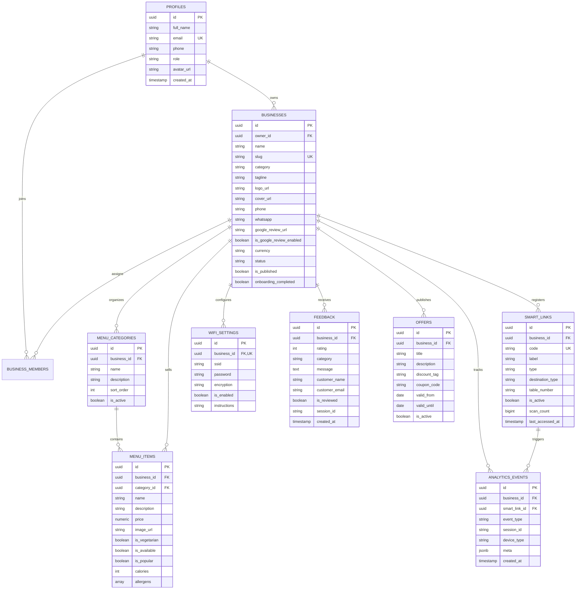

# NEXORA TECHNOLOGIES – DATABASE SCHEMA & RELATIONAL DESIGN

The Nexora Technologies database is built on **PostgreSQL** via **Supabase**, enforcing strict Row-Level Security (RLS) to safeguard multi-tenant data isolation.

---

## 1. Relational Entity Diagram

---

## 2. Table Catalog & Column Definitions

### 1. `profiles`
Linked 1-to-1 with Supabase `auth.users(id)`:
- `id`: UUID (Primary Key, Foreign Key -> `auth.users.id` on delete CASCADE).
- `full_name`: TEXT NOT NULL.
- `email`: TEXT UNIQUE NOT NULL.
- `phone`: TEXT (optional contact).
- `role`: TEXT NOT NULL (`super_admin`, `business_owner`, `team_member`).
- `avatar_url`: TEXT.
- `created_at`: TIMESTAMPTZ default `now()`.

### 2. `businesses`
Multi-tenant core record for each establishment:
- `id`: UUID (Primary Key).
- `owner_id`: UUID (Foreign Key -> `profiles.id`).
- `name`: TEXT NOT NULL (e.g., "Cafe Aroma").
- `slug`: TEXT UNIQUE NOT NULL (e.g., "cafe-aroma"). Used in `/b/:slug`.
- `tagline`: TEXT.
- `description`: TEXT.
- `category`: TEXT (`restaurant`, `cafe`, `hotel`, `retail`, `salon`, `services`, `other`).
- `logo_url`, `cover_url`: TEXT.
- `phone`, `whatsapp`, `email`, `website`, `address`, `city`, `google_maps_url`: TEXT.
- `google_review_url`: TEXT. Official Google Maps direct review link.
- `is_google_review_enabled`: BOOLEAN default `true`.
- `currency`: TEXT default `'INR'`.
- `currency_symbol`: TEXT default `'₹'`.
- `status`: TEXT default `'active'` (`active`, `suspended`, `pending`).
- `is_published`: BOOLEAN default `true`.
- `subscription_plan`: TEXT default `'starter'` (`starter`, `growth`, `enterprise`).
- `onboarding_completed`: BOOLEAN default `false`.

### 3. `menu_categories`
Category groupings for dishes and retail goods:
- `id`: UUID (Primary Key).
- `business_id`: UUID (Foreign Key -> `businesses.id`).
- `name`: TEXT NOT NULL.
- `sort_order`: INT default 0.
- `is_active`: BOOLEAN default `true`.

### 4. `menu_items`
Individual items and dishes:
- `id`: UUID (Primary Key).
- `business_id`: UUID (Foreign Key -> `businesses.id`).
- `category_id`: UUID (Foreign Key -> `menu_categories.id`).
- `name`: TEXT NOT NULL.
- `description`: TEXT.
- `price`: NUMERIC(10, 2) NOT NULL.
- `image_url`: TEXT.
- `is_vegetarian`: BOOLEAN default `true`.
- `is_available`: BOOLEAN default `true` (live 86'd stock toggle).
- `is_popular`: BOOLEAN default `false` (Chef's pick).
- `calories`: INT.
- `allergens`: TEXT[] (e.g. `['Dairy', 'Gluten']`).

### 5. `smart_links`
Physical tracking routes for QR table stands and NFC discs:
- `id`: UUID (Primary Key).
- `business_id`: UUID (Foreign Key -> `businesses.id`).
- `code`: TEXT UNIQUE NOT NULL (e.g., `cafe-t01`, `nfc-counter`). Used in `/go/:code`.
- `label`: TEXT (e.g., "Table 1 Acrylic Stand").
- `type`: TEXT (`qr`, `nfc`, `generic`).
- `destination_type`: TEXT (`profile`, `menu`, `review`, `wifi`, `custom`).
- `table_number`: TEXT (e.g., "T-01").
- `scan_count`: BIGINT default 0.
- `is_active`: BOOLEAN default `true`.

### 6. `wifi_settings`
Guest Wi-Fi configuration:
- `id`: UUID (Primary Key).
- `business_id`: UUID UNIQUE (Foreign Key -> `businesses.id`).
- `ssid`: TEXT NOT NULL.
- `password`: TEXT.
- `encryption`: TEXT default `'WPA'` (`WPA`, `WEP`, `nopass`).
- `is_enabled`: BOOLEAN default `true`.
- `instructions`: TEXT.

### 7. `feedback`
Private customer feedback records:
- `id`: UUID (Primary Key).
- `business_id`: UUID (Foreign Key -> `businesses.id`).
- `rating`: INT (1 to 5).
- `category`: TEXT (`food`, `service`, `cleanliness`, `pricing`, `ambience`, `other`).
- `message`: TEXT NOT NULL.
- `customer_name`, `customer_email`, `customer_phone`: TEXT.
- `is_reviewed`: BOOLEAN default `false`.
- `session_id`: TEXT (anonymous browser session).

### 8. `analytics_events`
Raw physical and digital user activity log:
- `id`: UUID (Primary Key).
- `business_id`: UUID (Foreign Key -> `businesses.id`).
- `smart_link_id`: UUID (Foreign Key -> `smart_links.id` nullable).
- `event_type`: TEXT (`page_view`, `qr_scan`, `nfc_tap`, `menu_view`, `product_view`, `review_click`, `feedback_submit`, `wifi_view`, `contact_click`).
- `session_id`: TEXT NOT NULL.
- `device_type`: TEXT (`mobile`, `tablet`, `desktop`).
- `meta`: JSONB default `{}`.
- `created_at`: TIMESTAMPTZ default `now()`.

