# NEXORA TECHNOLOGIES – PROJECT ARCHITECTURE & SYSTEM DESIGN
**Tagline:** ONE TAP. SMARTER BUSINESS.  
**Product:** Smart NFC + QR Solutions for Modern Businesses

---

## 1. System Overview & Architecture Model
Nexora Technologies is designed as a high-performance, multi-tenant Software-as-a-Service (SaaS) platform built for restaurants, cafés, boutique hotels, salons, and retail establishments.

```mermaid
graph TD
    subgraph "Physical Customer Access"
        A1["NFC Acrylic Table Stand / Disc\n(NDEF URL: /go/:code)"]
        A2["Custom High-Res QR Table Tent\n(URL: /go/:code)"]
        A3["Direct Domain Profile\n(URL: /b/:slug)"]
    end

    subgraph "Nexora Smart Router & Tracker (/go/:code)"
        R1["Identify Smart Link & Tenant ID"]
        R2["Record Analytics Event\n(qr_scan / nfc_tap + Session ID)"]
        R3["Fast Client-Side Redirect"]
    end

    subgraph "Customer Experience Layer"
        P1["Business Profile (/b/:slug)"]
        P2["Digital Menu (/b/:slug/menu)"]
        P3["Direct Google Reviews"]
        P4["Private Feedback Form"]
        P5["Guest Wi-Fi Auto-Connect"]
        P6["Active Promotional Offers"]
    end

    subgraph "Business Management Dashboard (/dashboard)"
        D1["Real-Time Overview & KPIs"]
        D2["Menu Manager (CRUD & Availability)"]
        D3["QR Generator & SVG/PNG Export"]
        D4["NFC Tag Manager & NDEF Formatter"]
        D5["Feedback Hub & CSV Export"]
        D6["Wi-Fi QR Tent Designer"]
        D7["Recharts Business Intelligence"]
        D8["Team Access & Permissions"]
        D9["6-Step Persistent Onboarding"]
    end

    subgraph "Super Admin Console (/admin)"
        S1["Platform-Wide Analytics"]
        S2["Tenant Directory & Approvals"]
        S3["Plan Subscription Enforcement"]
    end

    subgraph "Data & Backend Layer"
        B1["Supabase PostgreSQL with RLS"]
        B2["Supabase Authentication"]
        B3["Fallback Reactive Mock Layer"]
    end

    A1 --> R1
    A2 --> R1
    A3 --> P1
    R1 --> R2
    R2 --> B1
    R1 --> R3
    R3 --> P1
    R3 --> P2

    P1 --> P2
    P1 --> P3
    P1 --> P4
    P1 --> P5
    P1 --> P6

    D1 --> B1
    D2 --> B1
    D3 --> B1
    D4 --> B1
    D5 --> B1
    D6 --> B1
    D7 --> B1
    D8 --> B1
    S1 --> B1
    S2 --> B1
```

---

## 2. Component Decoupling & Isolation
1. **Customer-Facing Application (`/b/:slug`, `/b/:slug/menu`, `/go/:code`)**:
   - Mobile-first, lightweight bundle optimized for sub-second paint times on 4G/5G connections.
   - Zero authentication barrier for diners and customers.
   - Built-in dietary toggles (Vegetarian, Popular, Allergens) and table order cart drawer.
   - Direct-to-Google Maps redirect without rating gating or manipulation.
   - Standard Wi-Fi URI QR generation compatible with iOS and Android camera scanners.

2. **Business Owner Management Console (`/dashboard`)**:
   - Comprehensive multi-view interface with responsive collapsible navigation.
   - Interactive Recharts visualizers for physical scan distribution and daily visitor volume.
   - Real-time stock availability toggling ("In-Stock" vs "Sold Out").
   - Printable table tent preview modes with CSS `@media print` layout isolation.
   - Role-based team access (Owner, Manager/Admin, Staff).

3. **Super Admin Platform Console (`/admin`)**:
   - High-level tenant oversight, account approval queues, suspension levers, and platform interaction health.

4. **Data Layer Dual-Mode Engine (`src/services/dataService.ts`)**:
   - Operates against live Supabase PostgreSQL when credentials exist.
   - Employs self-initializing reactive local persistence with pre-seeded Cafe Aroma data for instant testing and zero-downtime offline demonstrations.

